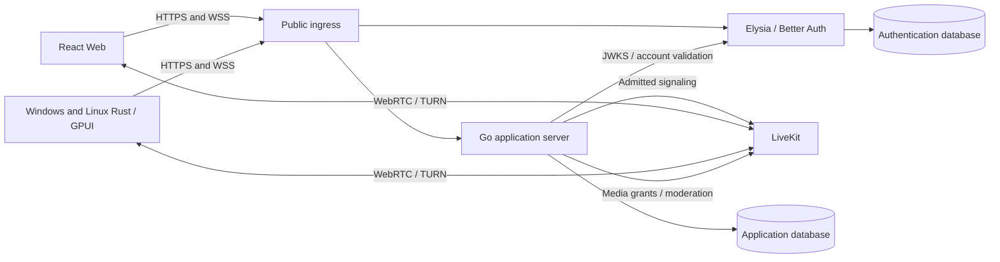

# Architecture

## Service boundaries

| Component              | Responsibility                                                                 | Implementation                                      |
| ---------------------- | ------------------------------------------------------------------------------ | --------------------------------------------------- |
| Web client             | Community UI, voice controls, moderation, administration                       | React, TypeScript, Tailwind, shadcn/ui with Base UI |
| Windows/Linux desktop  | Community UI, saved servers, voice controls, and platform integration          | Rust and GPUI                                       |
| Landing                | Public project information and downloads in EN/PL                              | Astro                                               |
| Application server     | Guests, membership, permissions, channels, messages, presence, voice admission | Go                                                  |
| Authentication service | Owner/moderator credentials and sessions, JWT signing and JWKS                 | Bun, TypeScript, Elysia 2 RC, Better Auth           |
| Media server           | WebRTC media transport and TURN connectivity                                   | Self-hosted LiveKit                                 |
| Database               | Durable application and authentication data                                    | PostgreSQL; separate databases and database roles   |
| Public ingress         | Trusted HTTPS and routing to local services                                    | Reverse proxy; implementation default: Caddy        |

All runtime services for one community belong to one Docker Compose project. The landing is deployed independently. Start with one host and one application-server instance. Multi-host clustering, Kubernetes, and federation are deferred.

Build-time tooling is separate from this runtime topology. pnpm owns JS/TS dependencies, Turborepo schedules repository tasks, Vite builds the React client, and Bun executes AUTH. Cargo owns the GPUI desktop build and Rust dependencies. See the [approved toolchain](toolchain.md) for tool ownership and integration.

The diagram shows the architecture for the first private release. HTTP ingress and media transport have distinct network requirements. Stage 1 must verify domains, public address advertisement, certificates, exposed ports, and restrictive-network fallback together. Additional media/TURN hostnames may be required even though users enter one community address.

## Native desktop direction

Rust and [GPUI](https://gpui.rs/) target Windows and Linux. GPUI renders the desktop interface. Native Rust code handles HTTP, WebSocket, session storage, and media integration. Web and all desktop clients share the versioned server contract and product behavior, including EN/PL copy. Go remains authoritative for application permissions and LiveKit continues to carry voice.

Stage 2 validates Windows and Linux GPUI integration with a prototype. Stage 4 packages the native client for those platforms. macOS uses Web for the first private release and gains a dedicated Swift client in [Stage 7](implementation-plan.md#stage-7--native-macos-client). The Stage 1 Electron shell is a frozen development reference. See the [Stage 4 release plan](implementation-plan.md#stage-4--desktop-and-first-private-release).

## Native mobile direction

[Stage 6](stage-6-mobile-plan.md) uses Kotlin Multiplatform for shared HTTP, event handling, and community state. The Android interface uses Kotlin and Jetpack Compose. The iOS and iPadOS interface uses Swift and SwiftUI. Both use the same versioned server contract as Web and desktop. Platform code owns secure storage, the LiveKit SDK, microphone permission, audio routing, and background call lifecycle. Go remains authoritative for admission and permissions. The macOS target implements the same protocol in Swift. Foundation handles HTTP and event sockets, Keychain stores credentials by origin, and the LiveKit Swift SDK handles media. Apple clients share SwiftUI components and the Swift room adapter. Only the mobile Apple target links the Kotlin framework.

## Identity and authorization

Go owns the community's participant identifiers and permissions. Better Auth owns registered-account authentication. A binding from a trusted authentication issuer and subject to a participant identifier connects them; Go never queries Better Auth's database directly.

Guests use a server-issued opaque credential and a persistent participant ID. Technical defaults:

- Browser guest credentials use same-origin secure HttpOnly cookies. Browser storage holds preferences and non-secret UI state, not privileged bearer tokens.
- GPUI desktop will isolate guest and account sessions by full server origin and protect persistent credentials with OS credential storage. Verify trusted TLS, restart and logout behavior, server switching, and session revocation on Windows and the supported Linux environments.
- Define and test the Rust client's HTTP and WebSocket session handling against the existing trusted-origin, cookie and ticket checks. Preserve browser protections and Go's authorization and signaling boundaries when adding native compatibility.
- The Stage 1 Electron shell kept credentials in its main process behind scoped IPC and used a sandboxed and context-isolated renderer. See the [Stage 1 evidence](evidence/stage-1.md) for the tested behavior.

Registered users authenticate with Better Auth. Its JWT plugin issues a short-lived token for Go to verify using JWKS. Validate the configured issuer, intended audience, signature algorithm, expiry, and subject. Fetch keys only from the installation's configured trusted issuer. A token-provided URL must never choose the trust source.

Cache JWKS with bounded refresh and planned key overlap during rotation. Unknown keys or invalid tokens fail closed. AUTH downtime must not stop established guest chat or voice. Valid registered-user tokens may continue within their expiry and cached-key policy; new login and refresh depend on AUTH availability. Test and document these boundaries.

JWT verification establishes identity; Go checks current roles, bans, and channel access at each privileged operation. Token expiry is not a substitute for immediate moderation or account revocation. Stage 1 defines and tests account/session revocation propagation from AUTH to Go, including active WebSocket connections. Keep this integration behind a small interface.

Public registration is disabled initially. Host-authorized setup creates the owner; the owner provisions local moderator accounts through Go and the private AUTH API. Future Google sign-in and participant accounts are extensions, not active features. No central account provider is required.

mTLS is deferred. Internal AUTH/Go communication uses the private Compose network; public access is routed through HTTPS. Databases and internal management endpoints are not exposed as public ports.

## Application protocols and persistence

Implementation defaults are a versioned HTTP JSON API with an OpenAPI contract, and WebSocket events for messages, presence, and channel changes. Share generated transport types with TypeScript clients; keep the protocol usable from Swift, Kotlin, and Rust.

Persist messages before acknowledging delivery or broadcasting committed events. Give sends a client-generated request identifier and enforce deduplication across retries. Clients reconcile by authoritative message IDs. After reconnect, recover durable history through the API; ephemeral events may be replaced by a current-state snapshot.

Go owns installations/settings, participants, account bindings, memberships, invitations, bans, categories, channels, messages, and moderation audit records. AUTH owns accounts, credentials, sessions, and signing-key persistence. Each service owns migrations for its own database and uses its own least-privilege database role.

Use foreign keys and indexes suited to stable message pagination and participant references. Treat invite redemption and usage limits transactionally. Keep presence ephemeral; do not require Redis solely for presence on the initial single-node deployment. Evaluate any LiveKit Redis requirement against the pinned deployment version in Stage 0 and record the outcome.

## Media admission and moderation

Go checks membership and permissions before issuing a narrowly scoped, short-lived LiveKit grant. Clients never receive a LiveKit server secret. Media identity is tied to the authoritative participant ID, not a user-selected nickname.

Go coordinates kick, ban, room departure, channel archival and forced mute with LiveKit. Moderation changes and voice grant invalidations commit together. Go closes affected signaling connections, removes the corresponding LiveKit identities, and retries incomplete removals. A forced-muted identity can obtain a fresh subscribe-only grant. Lifting the mute revokes that grant so the next join receives current publication permissions. Self-hosted LiveKit can still accept valid tokens at its private port, so all public signaling must pass the Go gate.

Go stores the latest verified guest address for optional IP blocking. The ingress reconstructs that address from the actual connection. A block supplements credential bans and applies to new and existing guest connections from the address. IP addresses stay out of the participant and audit responses. Live WebSocket connections check current membership and kick generation. Role changes take effect at the permission check regardless of token issue time.

Chat history is stored in PostgreSQL and transported by the application protocol, not treated as durable LiveKit room data. Audio is not recorded. The Web client serializes active room replacement, and every leave identifies its own grant. A network recovery request can replace its previous grant only while it is still current and unrevoked. PostgreSQL tracks pending LiveKit removals so a replacement grant does not start voice alongside a stale session.

GPUI uses the LiveKit Rust SDK with signaling through Go. The [desktop verification record](evidence/stage-4-desktop.md) records verified behavior and remaining platform checks. The [mobile plan](stage-6-mobile-plan.md) verifies the same signaling contract against the Android and Swift SDKs.

## Compatibility investigations

The following are implementation gates, not requests to reopen approved product decisions:

1. Pin the Elysia 2 release line, Bun, Better Auth, and JWT/JWKS integration. Run login, expiry, rotation, and revocation tests.
2. Stage 1 covered guest credential persistence and registered login in Web, and guest credential persistence in the Electron development shell. Verify both flows in Web and on the Windows and Linux GPUI packages before the first private release.
3. Demonstrate enforceable media moderation with self-hosted LiveKit.
4. Validate mobile browser devices, reconnect, and foreground audio on real devices.
5. Validate Oxlint's JS plugin integration with `@shadcn/lint` and determine an Oxfmt-compatible formatter strategy for Astro files.

Record the failing behavior, evidence, and proposed alternative when an implementation blocker requires changing an approved technology.

## Upstream references

References inspected during planning; recheck exact versions during Stage 0:

- [Elysia and Better Auth](https://elysiajs.com/integrations/better-auth)
- [Elysia 2 Beta](https://elysiajs.com/blog/elysia-20)
- [Better Auth JWT/JWKS](https://better-auth.com/docs/plugins/jwt)
- [Better Auth PostgreSQL](https://better-auth.com/docs/adapters/postgresql)
- [LiveKit self-hosting](https://docs.livekit.io/transport/self-hosting/)
- [LiveKit deployment and TURN](https://docs.livekit.io/transport/self-hosting/deployment/)
- [LiveKit distributed deployment](https://docs.livekit.io/transport/self-hosting/distributed/)
